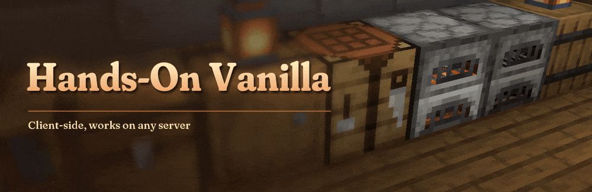
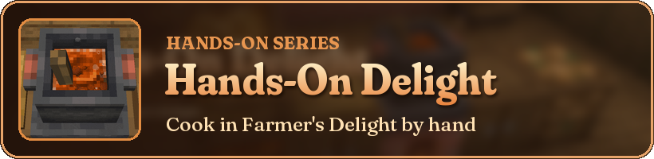
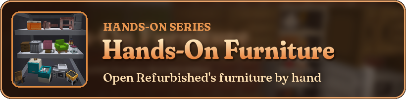
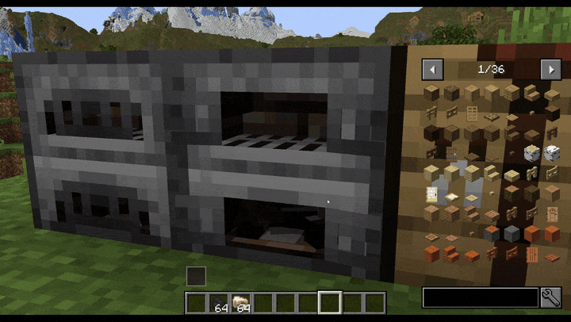

<!-- CurseForge description of Hands-On Vanilla. HTML: paste it in the editor's HTML (source) mode, not Markdown mode.
     The "more-mods" block is generated by tools/mod-catalog/sync_mod_links.py - never edit it by hand. -->

<!-- more-mods:start family -->

 &nbsp;

<!-- more-mods:end -->

    

<em>Craft and smelt with your own hands.</em>

<strong>The crafting table, all three furnaces, the stonecutter, the smithing table, the grindstone, the brewing stand and the anvil open right where they stand, with no menu screen. You lay the items into the grid yourself, take the result off the table and watch your ore on the furnace's grate. Client-side: it works on any server.</strong>

<strong>No menus</strong>, the blocks open in the world &nbsp;&middot;&nbsp; <strong>Every recipe</strong> of the game and your mods &nbsp;&middot;&nbsp; <strong>No new blocks or items</strong>

<h2 style="text-align:center">The crafting table</h2>

<em>Use the table and the camera glides to its top. Lay the items into the grid one by one or all at once, and take the result that hovers over it. Shift + click crafts as many as the grid allows.</em>

<h2 style="text-align:center">The furnace</h2>

<em>Its grille doors swing open: the ore lies on the grate, the fuel on the glowing coals below, and a thin bar shows how far it has cooked. Every furnace in the world shows what smelts in it.</em>

<h2 style="text-align:center">The recipe book</h2>

<em>A green book lies on the table's edge and has everything the vanilla one does, with a search, a "Made lately" tab and pages you turn with the wheel. Drag it where you like it and make it as big as you want.</em>

<h3 style="text-align:center">Getting started</h3>

Put the mod and <a href="https://www.curseforge.com/minecraft/mc-mods/diegesis">Diegesis</a> into the mods folder of the client, then right-click a crafting table, any furnace, a stonecutter, a smithing table, a grindstone, a brewing stand or an anvil. On <a href="https://fabricmc.net">Fabric</a> it needs <a href="https://www.curseforge.com/minecraft/mc-mods/fabric-api">Fabric API</a> too. The server needs none of them: the stations use the game's own menus, and every vanilla click works at them. <code>config/handson_vanilla.properties</code> turns off any station or the recipe book.

 Bug reports, questions and ideas for new stations are welcome in <a href="https://discord.gg/mGkPKccJEf">Pocky's Kitchen</a>, our Discord server.

Made by <strong>Pocky</strong>, the maker of <a href="https://www.curseforge.com/minecraft/mc-mods/hands-on-delight">Hands-On Delight</a>. Built on <a href="https://www.curseforge.com/minecraft/mc-mods/diegesis">Diegesis</a>. Source on <a href="https://github.com/Pocky-l/handson-vanilla">GitHub</a> (MIT).

