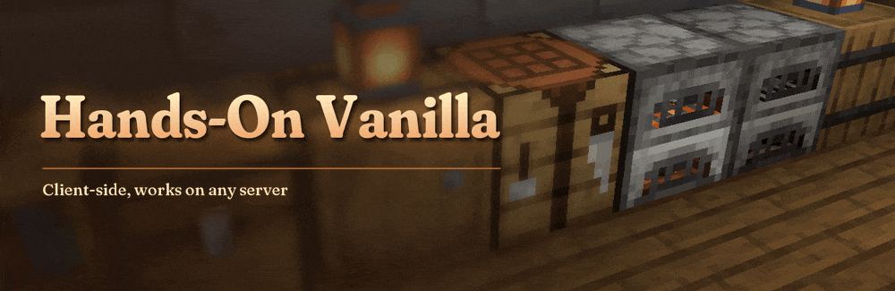

<p align="center">
  
</p>

<p align="center">
  <a href="https://www.curseforge.com/minecraft/mc-mods/hands-on-vanilla"></a>
  <a href="https://www.curseforge.com/minecraft/mc-mods/hands-on-vanilla/files"></a>
  <a href="https://files.minecraftforge.net"></a>
  <a href="https://www.curseforge.com/minecraft/mc-mods/hands-on-vanilla"></a>
  <a href="https://discord.gg/mGkPKccJEf"></a>
  <a href="LICENSE"></a>
</p>

<p align="center"><i>Craft and smelt with your own hands.</i></p>

<p align="center"><b>The crafting table, all three furnaces, the stonecutter, the smithing table, the grindstone, the brewing stand, the anvil, the enchanting table, the lectern, the loom and the cartography table open right where they stand, with no menu screen. You lay the items into the grid yourself, take the result off the table and watch your ore on the furnace's grate. Client-side: it works on any server.</b></p>

<p align="center"></p>

<p align="center"></p>

<p align="center"><b>No menus</b>, the blocks open in the world &middot; <b>Every recipe</b> of the game and your mods &middot; <b>No new blocks or items</b></p>

Built on [Diegesis](https://www.curseforge.com/minecraft/mc-mods/diegesis), from the maker of
[Hands-On Delight](https://www.curseforge.com/minecraft/mc-mods/hands-on-delight).

## Features

- **Crafting table.** Use it and the camera glides to its top. Pick a stack from your inventory, lay it into the grid
  one by one or all at once, and the result hovers over the table, its count turned to you. Take it with a click, or
  Shift + click to craft as many as the grid allows.
- **Furnace.** Its grille doors swing open: what smelts lies on the grate in its mouth, the result beside it, and the
  fuel on the coals below, glowing while it burns. A thin bar over the grate fills as it cooks. Use a furnace with ore
  or coal in hand and it goes in by itself.
- **Smoker.** Its glazed door swings out like an oven's: the food lies on an iron rack in the chamber, the fuel in front
  of the logs that burn below, and smoke seeps out round the door while it cooks.
- **Blast furnace.** Its iron hatch drops open like an oven door: the ore lies on a cast iron grate in the hearth, the result
  beside it, and the fuel on the glowing coals under the grate.
- **Stonecutter.** Pick a piece in the recipe book beside it and all the stone on the slab is fed through the turning saw,
  dust flying; the pieces drop beside it and fly into your inventory. Shift + click cuts one piece. A page whose stone is not
  on the slab lays it there from your inventory.
- **Smithing table.** The hammer hanging on its side comes down onto the iron plate. Lay the template, the gear and the
  material on the plate, and what they make hovers beside them; click the hammer or the result and the hammer strikes,
  sparks fly, and the new gear is in your hand. Shift + click puts it into your inventory.
- **Grindstone.** On the floor, a wall or the ceiling, from any side: the two pieces are held up to the stone and what they
  make hovers over the wheel. Click the wheel or the result and they are pressed to the turning stone, sparks fly, and
  the mended or disenchanted piece is in your hand, the experience orbs flying to you.
- **Brewing stand.** The bottles stand on the stand's own stone feet, the ingredient on top of the rod, the blaze powder at
  its foot. While it brews the ingredient melts away bit by bit, drops fall from it, bubbles of each potion's colour rise in
  the bottles and a small flame burns under the rod.
- **Anvil.** The two pieces lie side by side on its face, what they make hovers over it, and above that a name tag shows
  the name it will bear and what it costs. Click the name to type a new one; click the result and a hammer comes down on
  the anvil, sparks fly, and the piece is yours.
- **Enchanting table.** Its book comes to you and opens over the table with the three offers written on its pages: the
  clue and what it costs on the left, the runes and the level needed on the right. The lapis lies down by itself; click an
  offer to enchant.
- **Lectern.** Read the book right on the lectern, two pages at once. Turn the pages with a click on their foot, the wheel
  or Page Up and Page Down, and take the book by its ribbon.
- **Loom.** The banner hangs over the loom and shows the pattern under the cursor before you weave it. Click a pattern in
  the book beside it and the shuttle weaves it into the cloth; the banner stays on the loom for the next layer.
- **Cartography table.** The map lies on the table as a map, and what it will become hovers over it: a wider map, two
  copies or the map under glass. Click it to take it.
- **Furnaces in the world.** Every furnace shows its open mouth, grate and coals, every smoker its rack and logs behind a
  glazed door, every blast furnace its hearth behind the hatch's slits, with flames and smoke inside when lit, and what
  cooks in them. On a server you see what you last saw in it.
- **Recipe book.** A green book lies on the table's edge. Click it and it opens beside the table with everything the
  vanilla book has: recipes of one kind share a place (right click lays them all out), a switch for what you can craft
  now, red marks on new recipes, and a see-through recipe in the grid when items are missing.
- **Finding a recipe.** Type into the book's search to find recipes by name or by mod id. The mouse wheel, Page Up and
  Page Down or a click on either half of the page turns the pages; hold the click to leaf through. A "Made lately" tab
  keeps the last 24 recipes you crafted from it.
- **The book stays where you like it.** Drag it by its cover to move it, by its top right corner to make it bigger or
  smaller; a right click puts it back. Its tab, page, size and place are kept.
- **Every vanilla click.** Left and right clicks, Shift + click, dragging, double clicks, the number keys, Q and the
  off-hand key work as in the vanilla screen, and the mouse wheel over a slot puts one item in or takes one back.
- **Client-side.** The stations use the game's own menus, so the mod works on any server, with or without it.

## Controls

| Action | How |
|---|---|
| Open a station | Right-click a crafting table, furnace, smoker, blast furnace, stonecutter, smithing table, grindstone, brewing stand, anvil, enchanting table, lectern with a book, loom or cartography table |
| Cut stone | Click a piece in the stonecutter's book to cut all the stone on the slab; Shift + click cuts one |
| Upgrade or trim gear | Click the smithing table's hammer or the result over the plate; Shift + click sends it to the inventory |
| Mend or disenchant | Click the grindstone's wheel or the result over it; Shift + click sends it to the inventory |
| Rename on the anvil | Click the name over the anvil, type, then Enter; the first key replaces the whole name |
| Take from the anvil | Click the result over it; Shift + click sends it to the inventory |
| Enchant | Click an offer on the enchanting table's book |
| Read on a lectern | Click the foot of a page, use the wheel or Page Up and Page Down; click the ribbon to take the book |
| Weave a banner | Click a pattern in the loom's book; Shift + click weaves the whole stack |
| Place a block on it | Sneak + right-click with the block in hand |
| Put items in | Click a stack in your inventory, then the cell: left click lays all, right click one |
| Spread a stack | Drag it over the cells |
| Craft | Click the result; Shift + click crafts as many as you can |
| Open the recipe book | Click the book on the table's edge |
| Leave | Escape or the inventory key |

## Compatibility

[](https://www.curseforge.com/minecraft/mc-mods/jei) ✅ **[JEI](https://www.curseforge.com/minecraft/mc-mods/jei)** (optional) - its keys work over the stations' items, its + lays a recipe into the table

[](https://www.curseforge.com/minecraft/mc-mods/emi) ✅ **[EMI](https://www.curseforge.com/minecraft/mc-mods/emi)** (optional) - its keys work over the stations' items

[](https://www.curseforge.com/minecraft/mc-mods/visual-workbench) ✅ **[Visual Workbench](https://www.curseforge.com/minecraft/mc-mods/visual-workbench)** (optional) - its tables are worked by hand too

[](https://www.curseforge.com/minecraft/mc-mods/fastworkbench) ✅ **[FastWorkbench](https://www.curseforge.com/minecraft/mc-mods/fastworkbench)** (optional) - the result shows on the table

[](https://www.curseforge.com/minecraft/mc-mods/polymorph) ✅ **[Polymorph](https://www.curseforge.com/minecraft/mc-mods/polymorph)** (optional) - the other results of a grid lie beside it, click one to make it

[](https://www.curseforge.com/minecraft/mc-mods/crafting-tweaks) ✅ **[Crafting Tweaks](https://www.curseforge.com/minecraft/mc-mods/crafting-tweaks)** (optional) - its rotate, balance and clear are marks on the table's edge, its keys work there too

[](https://www.curseforge.com/minecraft/mc-mods/easy-magic) ✅ **[Easy Magic](https://www.curseforge.com/minecraft/mc-mods/easy-magic)** (optional) - the enchanting table keeps its items, the book's turned-down corner buys new offers

[](https://www.curseforge.com/minecraft/mc-mods/mouse-tweaks) ✅ **[Mouse Tweaks](https://www.curseforge.com/minecraft/mc-mods/mouse-tweaks)** (optional) - its drags work at both stations

Resource packs keep their furnace, smoker and blast furnace textures. The open furnaces stay this mod's, so a pack cannot misplace what lies in them.

## Configuration

`config/handson_vanilla.properties`, read at startup.

| Key | Default | What it does |
|---|---|---|
| `crafting_table` | `true` | The crafting table as a station. Off, it opens its vanilla screen |
| `furnace` | `true` | The furnace as a station, and its open look in the world. Off, it is vanilla's again |
| `smoker` | `true` | The smoker as a station, and its open look in the world. Off, it is vanilla's again |
| `blast_furnace` | `true` | The blast furnace as a station, and its open look in the world. Off, it is vanilla's again |
| `stonecutter` | `true` | The stonecutter as a station. Off, it opens its vanilla screen |
| `smithing_table` | `true` | The smithing table as a station. Off, it opens its vanilla screen |
| `grindstone` | `true` | The grindstone as a station. Off, it opens its vanilla screen |
| `brewing_stand` | `true` | The brewing stand as a station. Off, it opens its vanilla screen |
| `anvil` | `true` | The anvil as a station. Off, it opens its vanilla screen |
| `enchanting_table` | `true` | The enchanting table as a station. Off, it opens its vanilla screen |
| `lectern` | `true` | A book on a lectern is read on the lectern. Off, it opens its vanilla screen |
| `loom` | `true` | The loom as a station. Off, it opens its vanilla screen |
| `cartography_table` | `true` | The cartography table as a station. Off, it opens its vanilla screen |
| `recipe_book` | `true` | The recipe book beside the crafting table |
| `sound_volume` | `1.0` | The stations' own sounds, from `0` (silent) to `1` |

## Installation

1. Minecraft 1.20.1 with [Forge](https://files.minecraftforge.net) or [Fabric](https://fabricmc.net), or Minecraft
   1.21.1 with [NeoForge](https://neoforged.net) or Fabric. Fabric also needs
   [Fabric API](https://www.curseforge.com/minecraft/mc-mods/fabric-api).
2. [Diegesis](https://www.curseforge.com/minecraft/mc-mods/diegesis) and this mod in the `mods` folder of the client. The
   server needs neither.

Bug reports, questions and ideas for new stations are welcome in [Pocky's Kitchen](https://discord.gg/mGkPKccJEf), our
Discord server.

## Building

```sh
./gradlew build
```

The jars are written to `forge/build/libs/` and `fabric/build/libs/`. The `1.21.1` branch builds `neoforge/` and
`fabric/`.

## Credits

- Author: **Pocky**.
- Built on [Diegesis](https://www.curseforge.com/minecraft/mc-mods/diegesis). The furnace's lining, grate and doors, the
  smoker's rack and door, the blast furnace's hatch and the smithing hammer are this mod's own textures; everything else comes from the game.

<!-- more-mods:start -->
## More mods by Pocky

**🌦️ Weather & nature**

<table>
  <tr>
    <td width="56"><a href="https://www.curseforge.com/minecraft/mc-mods/hoarfrost-snow-blizzards"></a></td>
    <td><a href="https://www.curseforge.com/minecraft/mc-mods/hoarfrost-snow-blizzards"><b>Hoarfrost: Snow & Blizzards</b></a> - seven kinds of snowfall, a living wind and soft snow on the land (<a href="https://github.com/Pocky-l/hoarfrost">source</a>)</td>
  </tr>
  <tr>
    <td width="56"><a href="https://www.curseforge.com/minecraft/mc-mods/petrichor-rain-storms"></a></td>
    <td><a href="https://www.curseforge.com/minecraft/mc-mods/petrichor-rain-storms"><b>Petrichor: Rain & Storms</b></a> - realistic rain, puddles, drips and branching lightning (<a href="https://github.com/Pocky-l/petrichor">source</a>)</td>
  </tr>
  <tr>
    <td width="56"><a href="https://www.curseforge.com/minecraft/mc-mods/rustling-leaves"></a></td>
    <td><a href="https://www.curseforge.com/minecraft/mc-mods/rustling-leaves"><b>Rustling Leaves</b></a> - falling leaves and leaf piles you can wade through and rake, client-side (<a href="https://github.com/Pocky-l/rustling-leaves">source</a>)</td>
  </tr>
</table>

**🎨 Graphics & performance**

<table>
  <tr>
    <td width="56"><a href="https://www.curseforge.com/minecraft/mc-mods/turbo-for-distant-horizons"></a></td>
    <td><a href="https://www.curseforge.com/minecraft/mc-mods/turbo-for-distant-horizons"><b>Turbo for Distant Horizons</b></a> - Distant Horizons terrain generated several times faster (<a href="https://github.com/Pocky-l/dhturbo">source</a>)</td>
  </tr>
  <tr>
    <td width="56"><a href="https://www.curseforge.com/minecraft/shaders/pocky-shaders"></a></td>
    <td><a href="https://www.curseforge.com/minecraft/shaders/pocky-shaders"><b>Pocky Shaders</b></a> - a cosy, natural shader pack that shows the weather of these mods (<a href="https://github.com/Pocky-l/pocky-shaders">source</a>)</td>
  </tr>
</table>

**🔮 Magic**

<table>
  <tr>
    <td width="56"><a href="https://www.curseforge.com/minecraft/mc-mods/hextale"></a></td>
    <td><a href="https://www.curseforge.com/minecraft/mc-mods/hextale"><b>HexTale</b></a> - hextech magic to research, distil and bind with runes, inspired by Arcane and Thaumcraft (<a href="https://github.com/Pocky-l/HexTale">source</a>)</td>
  </tr>
</table>

**⚡ Tech & energy**

<table>
  <tr>
    <td width="56"><a href="https://www.curseforge.com/minecraft/mc-mods/mekanism-advancedgenerators"></a></td>
    <td><a href="https://www.curseforge.com/minecraft/mc-mods/mekanism-advancedgenerators"><b>Mekanism Advanced Generators</b></a> - nine tiers of solar panels, big solar generators, cubes and cables for Mekanism (<a href="https://github.com/Pocky-l/Mekanism-MoreSolarPanels">source</a>)</td>
  </tr>
</table>

**🛠️ Server tools**

<table>
  <tr>
    <td width="56"><a href="https://www.curseforge.com/minecraft/mc-mods/inventory-backups"></a></td>
    <td><a href="https://www.curseforge.com/minecraft/mc-mods/inventory-backups"><b>Inventory Backups</b></a> - inventory and ender chest backups with one-click restore for admins (<a href="https://github.com/Pocky-l/inventory-backups">source</a>)</td>
  </tr>
</table>

**🧩 Libraries & addons**

<table>
  <tr>
    <td width="56"><a href="https://www.curseforge.com/minecraft/mc-mods/diegesis"></a></td>
    <td><a href="https://www.curseforge.com/minecraft/mc-mods/diegesis"><b>Diegesis</b></a> - a library for interfaces you work with right on the block, with no menu screen (<a href="https://github.com/Pocky-l/diegesis">source</a>)</td>
  </tr>
  <tr>
    <td width="56"><a href="https://www.curseforge.com/minecraft/mc-mods/hands-on-delight"></a></td>
    <td><a href="https://www.curseforge.com/minecraft/mc-mods/hands-on-delight"><b>Hands-On Delight</b></a> - cook in Farmer's Delight with your own hands, right on its blocks (<a href="https://github.com/Pocky-l/handson-delight">source</a>)</td>
  </tr>
  <tr>
    <td width="56"><a href="https://www.curseforge.com/minecraft/mc-mods/hands-on-furniture"></a></td>
    <td><a href="https://www.curseforge.com/minecraft/mc-mods/hands-on-furniture"><b>Hands-On Furniture</b></a> - open MrCrayfish's fridges, cabinets and drawers by hand and put food anywhere on their shelves (<a href="https://github.com/Pocky-l/handson-furniture">source</a>)</td>
  </tr>
</table>

<!-- more-mods:end -->

## License

[MIT](LICENSE)
